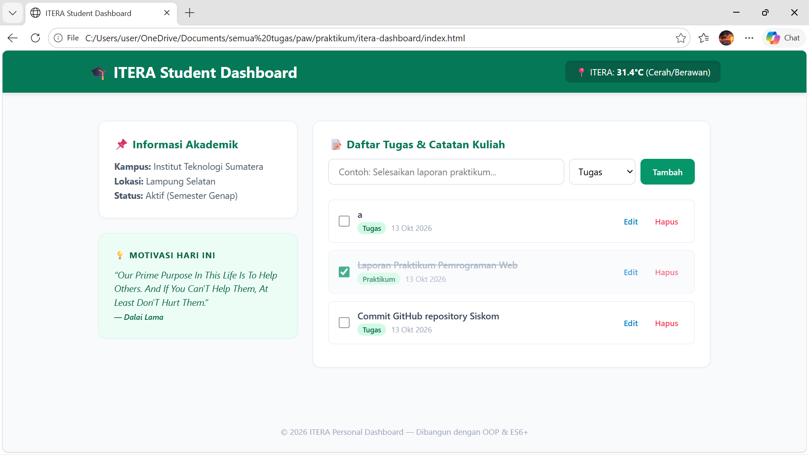

# ITERA Personal Dashboard

## Penjelasan Singkat
Aplikasi **ITERA Personal Dashboard** adalah aplikasi web produktivitas harian yang dirancang khusus untuk mahasiswa Institut Teknologi Sumatera (ITERA). Aplikasi ini membantu mahasiswa dalam mengelola daftar tugas kuliah, catatan praktikum, dan jadwal secara interaktif. Dilengkapi dengan widget cuaca real-time kampus berbasis koordinat Lampung Selatan (`Open-Meteo API`) serta kutipan motivasi harian (`DummyJSON Quotes API`).

## 📸 Screenshot Antarmuka

## Daftar Fitur ES6+ yang Diimplementasikan & Lokasi Kode

| Fitur ES6+ | Deskripsi Implementasi | Nama File & Baris Kode |
| :--- | :--- | :--- |
| **`let` & `const`** | Digunakan secara konsisten untuk deklarasi variabel block-scoped di seluruh logika aplikasi. | `app.js` (Seluruh baris) |
| **Arrow Functions** | Diimplementasikan pada fungsi `renderTasks`, `fetchWeatherData`, dan `fetchRandomQuote`. | `app.js` (Baris 131, 178, 197) |
| **Template Literals** | Digunakan untuk rendering dinamis elemen HTML daftar tugas (`task-list`) dan modal edit. | `app.js` (Baris 138 & 96) |
| **Async / Await** | Digunakan pada operasi asynchronous untuk melakukan `fetch()` data cuaca Open-Meteo dan DummyJSON Quotes. | `app.js` (Baris 18, 178, 197) |
| **Classes** | Menerapkan OOP modern menggunakan `class TaskItem` dan `class DashboardApp`. | `app.js` (Baris 5 & 14) |
| **Destructuring & Spread Operator** | Digunakan saat membaca state dari LocalStorage, mengambil properti API, serta memperbarui array state (`this.tasks = [newTask, ...this.tasks]`). | `app.js` (Baris 33, 76, 122) |