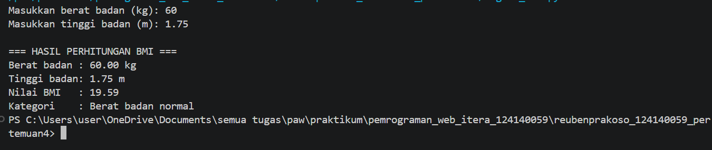
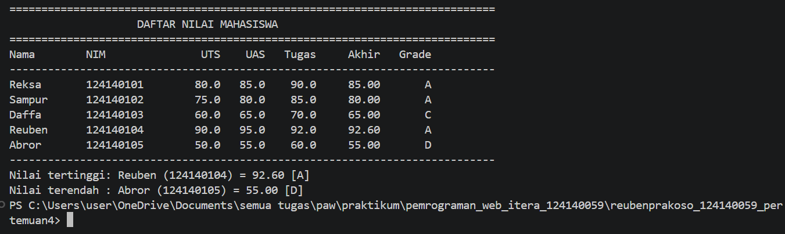
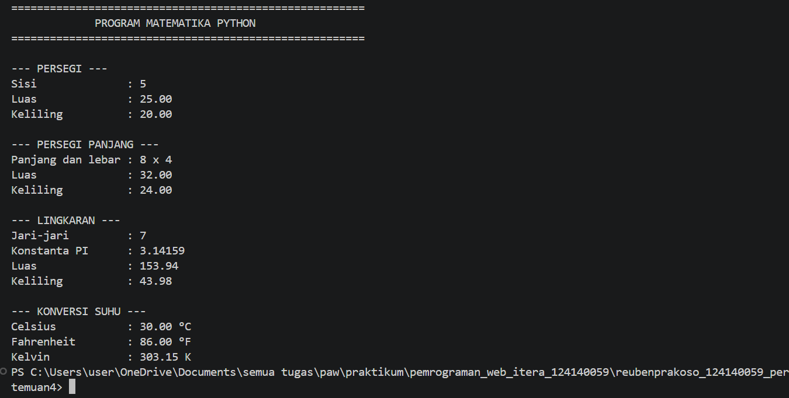

# Praktikum Pengembangan Aplikasi Web — Pertemuan 4

## Identitas Mahasiswa

- **Nama:** Reuben Prakoso
- **NIM:** 124140059
- **Kelas:** RA
- **Program Studi:** Teknik Informatika

## Deskripsi Tugas

### 1. `tugas1_bmi.py` — Penghitung BMI

Program meminta masukan berat badan (kg) dan tinggi badan (m), menghitung BMI menggunakan rumus:

`BMI = berat / (tinggi * tinggi)`

Selanjutnya, program menentukan kategori berat badan menggunakan percabangan `if-elif-else`.

Kategori yang digunakan:
- BMI < 18.5: Berat badan kurang
- 18.5 ≤ BMI < 25: Berat badan normal
- 25 ≤ BMI < 30: Berat badan berlebih
- BMI ≥ 30: Obesitas

### 2. `tugas2_nilai_mahasiswa.py` — Pengelolaan Nilai Mahasiswa

Program menggunakan list yang berisi lima dictionary mahasiswa. Nilai akhir dihitung dengan bobot 30% UTS, 40% UAS, dan 30% tugas.

Program menentukan grade A–E, menampilkan tabel nilai mahasiswa, serta mencari mahasiswa dengan nilai akhir tertinggi dan terendah.

**Catatan:** Nama, NIM, dan nilai pada program ini merupakan data contoh untuk menguji program. Data dapat disesuaikan jika dosen memberikan data tertentu.

### 3. `math_operations.py` dan `main.py` — Modul Matematika

File `math_operations.py` berisi konstanta `PI`, fungsi untuk menghitung luas dan keliling persegi, persegi panjang, dan lingkaran, serta fungsi konversi suhu dari Celsius ke Fahrenheit dan Kelvin.

File `main.py` mengimpor modul dan beberapa fungsi secara langsung, kemudian menjalankan seluruh fungsi menggunakan contoh nilai.

## Cara Menjalankan Program

Buka folder proyek di Visual Studio Code, kemudian buka terminal pada folder yang sama. Pastikan Python sudah terpasang.

Jalankan setiap program menggunakan perintah berikut:

```bash
python tugas1_bmi.py
python tugas2_nilai_mahasiswa.py
python main.py
```

Untuk Windows, jika perintah `python` tidak dikenali, gunakan `py`, misalnya:

```bash
py tugas1_bmi.py
```

## Bukti Hasil Eksekusi

Berikut merupakan screenshot hasil pengujian ketiga program yang dijalankan melalui terminal.

### 1. Screenshot Program BMI

Screenshot menunjukkan proses input berat badan 60 kg dan tinggi badan 1.75 meter, serta hasil perhitungan BMI sebesar 19.59 dengan kategori berat badan normal.



### 2. Screenshot Program Nilai Mahasiswa

Screenshot menunjukkan tabel nilai lima mahasiswa, perhitungan nilai akhir, grade, serta informasi mahasiswa dengan nilai tertinggi dan terendah.



### 3. Screenshot Program Matematika Python

Screenshot menunjukkan hasil perhitungan luas dan keliling persegi, persegi panjang, lingkaran, serta konversi suhu Celsius ke Fahrenheit dan Kelvin.



## Struktur Folder

```text
ReubenPrakoso_124140059_pertemuan4/
├── .gitignore
├── README.md
├── tugas1_bmi.py
├── tugas2_nilai_mahasiswa.py
├── math_operations.py
├── main.py
└── screenshots/
    ├── tugas1_bmi.png
    ├── tugas2_nilai_mahasiswa.png
    └── tugas3_math_operations.png
```

## Kesimpulan

Berdasarkan praktikum Pertemuan 4, ketiga program telah berhasil dijalankan. Praktikum ini menerapkan konsep dasar Python, meliputi input dan output, operasi aritmatika, percabangan, list, dictionary, perulangan, fungsi, serta penggunaan modul dan import.