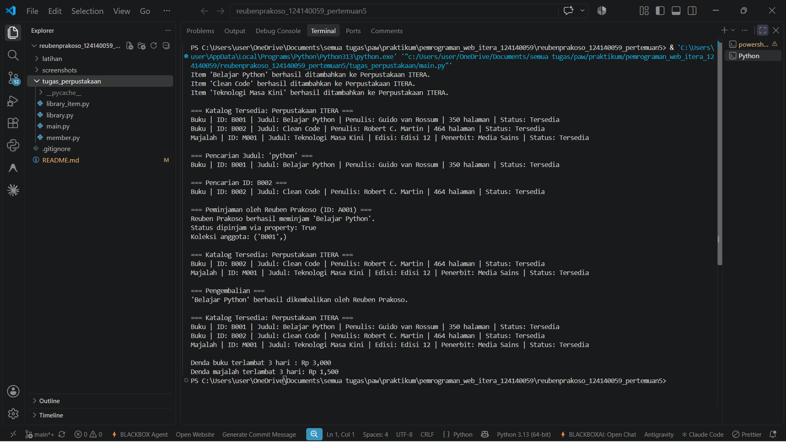

# Praktikum Pengembangan Aplikasi Web — Pertemuan 5

## Identitas Mahasiswa

- **Nama:** Reuben Prakoso
- **NIM:** 124140059
- **Kelas Praktikum:** RA
- **Program Studi:** Teknik Informatika

## Deskripsi

Praktikum ini berisi contoh Python OOP untuk class dan object, inheritance,
encapsulation, polymorphism, serta abstract class. Folder `latihan/` berisi
tujuh program hands-on dan lima latihan mandiri.

Tugas utama berupa sistem manajemen perpustakaan sederhana dengan fitur
menambah item, melihat katalog yang tersedia, mencari berdasarkan ID/judul,
serta meminjam dan mengembalikan item.

## Penerapan OOP pada Tugas Perpustakaan

- **Class dan object:** `Book`, `Magazine`, `Member`, dan `Library` memodelkan
  item, anggota, dan pengelola koleksi.
- **Inheritance dan abstraction:** `LibraryItem` adalah abstract base class;
  `Book` dan `Magazine` mewarisi dan mengimplementasikan `get_detail()` serta
  `hitung_denda()`.
- **Encapsulation:** koleksi perpustakaan, identitas anggota, daftar pinjaman,
  ID item, dan judul disimpan dalam atribut private. Status pinjam dibaca
  melalui property `is_dipinjam`.
- **Polymorphism:** katalog memanggil `get_detail()` pada item tanpa perlu
  membedakan subclass. Perhitungan denda juga memiliki nilai berbeda untuk
  buku dan majalah.
- **Validasi:** ID item duplikat ditolak; item hanya dapat dipinjam jika
  tersedia dan hanya dapat dikembalikan oleh anggota peminjam.

## Cara Menjalankan

Pastikan Python 3.10 atau lebih baru telah terpasang. Jalankan tugas utama dari
folder `tugas_perpustakaan`:

```bash
cd tugas_perpustakaan
python main.py
```

Jalankan program latihan dari direktori pertemuan:

```bash
python latihan/01_everything_is_object.py
python latihan/01_procedural_vs_oop.py
python latihan/02_class_object.py
python latihan/03_inheritance.py
python latihan/04_encapsulation.py
python latihan/05_polymorphism.py
python latihan/06_abstract_class.py
```

Latihan mandiri dapat dijalankan dengan perintah berikut:

```bash
python latihan/latihan_buku.py
python latihan/latihan_truk.py
python latihan/latihan_karyawan.py
python latihan/latihan_notifikasi.py
python latihan/latihan_storage.py
```

Jika perintah `python` tidak dikenali di Windows, gunakan `py` sebagai
penggantinya.

## Screenshot Output

Lampirkan screenshot terminal setelah menjalankan `python main.py` yang
memperlihatkan penambahan item, katalog, pencarian, dan status peminjaman.
Simpan tangkapan layar asli sebagai `screenshots/tugas_perpustakaan.png`.
Screenshot harus merekam hasil eksekusi aktual di komputer.



## Struktur Folder

```text
reubenprakoso_124140059_pertemuan5/
├── .gitignore
├── README.md
├── screenshots/
│   └── tugas_perpustakaan.png
├── latihan/
│   ├── 01_everything_is_object.py
│   ├── 01_procedural_vs_oop.py
│   ├── 02_class_object.py
│   ├── 03_inheritance.py
│   ├── 04_encapsulation.py
│   ├── 05_polymorphism.py
│   ├── 06_abstract_class.py
│   ├── latihan_buku.py
│   ├── latihan_truk.py
│   ├── latihan_karyawan.py
│   ├── latihan_notifikasi.py
│   └── latihan_storage.py
└── tugas_perpustakaan/
    ├── library_item.py
    ├── member.py
    ├── library.py
    └── main.py
```

Cache Python (`__pycache__/`, `*.pyc`) dan virtual environment (`venv/`,
`.venv/`) diabaikan oleh `.gitignore`.
